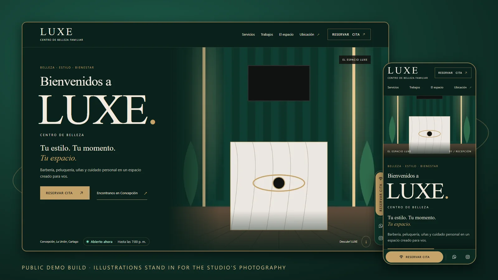
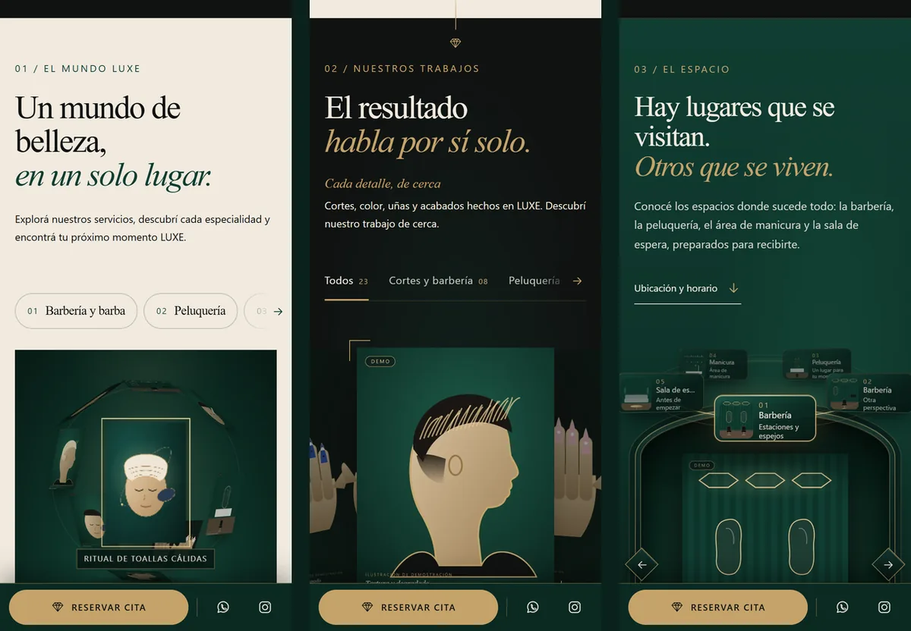
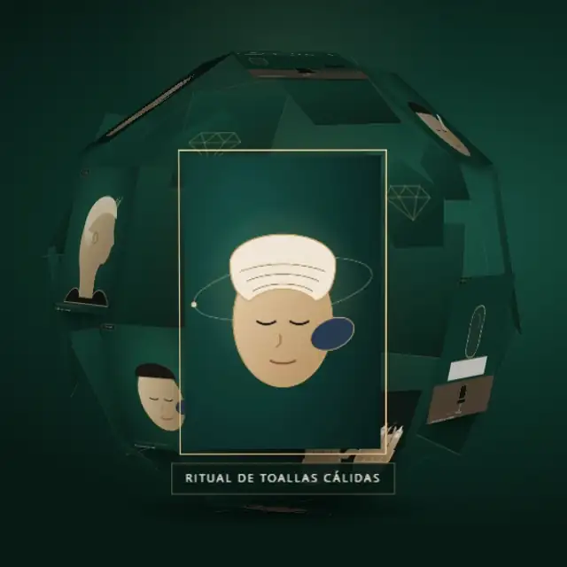
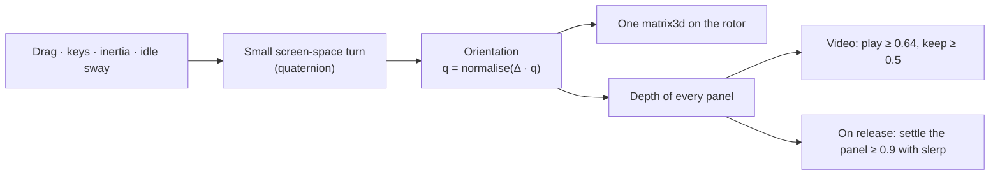
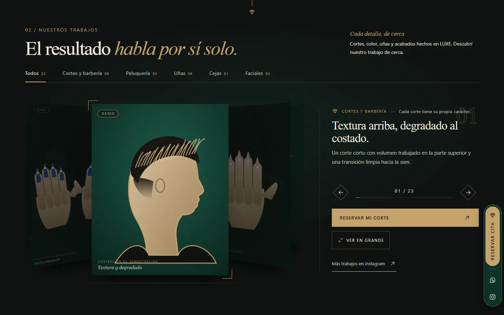
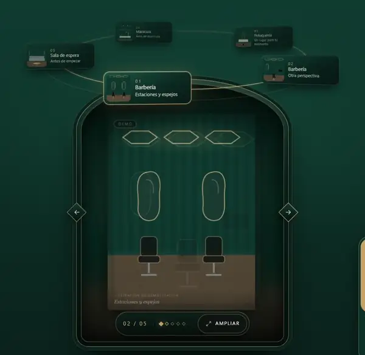
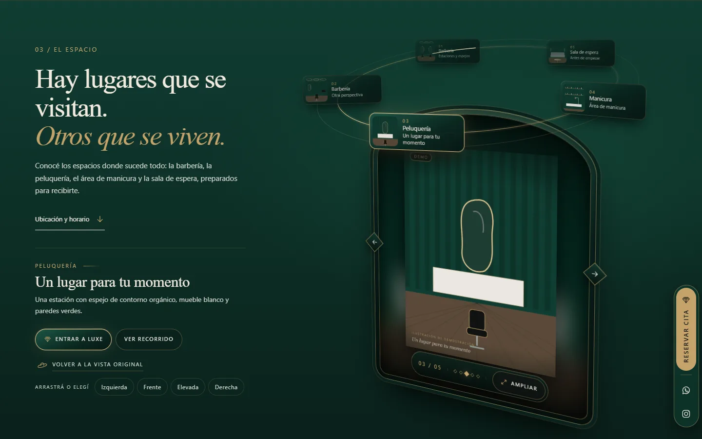
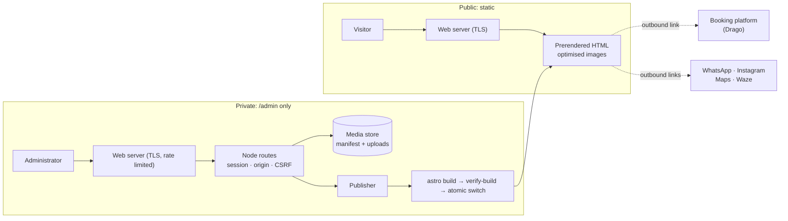

<h1 align="center">LUXE Centro de Belleza</h1>

<p align="center"><em>A custom website and photo admin for a beauty studio in Costa Rica</em></p>

<p align="center">
  <a href="https://www.luxecentrobelleza.com"><strong>Live site</strong></a> ·
  <a href="docs/case-study/interactive-globe.md">Case studies</a> ·
  <a href="docs/architecture.md">Architecture</a> ·
  <a href="#run-it-locally">Run it locally</a>
</p>

<p align="center">
  
</p>

<p align="center">
  <sub>Astro 7 · TypeScript (strict) · CSS 3D + quaternion math · Node admin · Playwright</sub>
</p>

LUXE is a beauty studio in Concepción, La Unión, Cartago. Its website had to feel like the
place itself, explain five specialities, show real work, show the rooms, and send visitors to
the studio's existing booking system. Later in the project the business also needed to change
its photos without a developer.

This repository is the public-source version of that production site. The interface, the
interactive pieces and the admin are the real implementation; the media are not.

> [!NOTE]
> **Demonstration media.** The studio's photographs, videos and logo are not in this
> repository. Every image and clip here is a generated illustration labelled `DEMO`, with the
> same ids, categories and aspect ratios as the originals, so every interaction behaves as in
> production. All screenshots below come from that local demo build. The live site at
> [luxecentrobelleza.com](https://www.luxecentrobelleza.com) shows the real photography.

---

## Contents

1. [The challenge](#the-challenge)
2. [Discovery and requirements](#discovery-and-requirements)
3. [Visual identity](#visual-identity)
4. [The world of LUXE: a CSS 3D globe](#the-world-of-luxe-a-css-3d-globe)
5. [Editorial portfolio](#editorial-portfolio)
6. [The space: an orbit inspired by Saturn's rings](#the-space-an-orbit-inspired-by-saturns-rings)
7. [Architecture](#architecture)
8. [Security by design](#security-by-design)
9. [Quality engineering](#quality-engineering)
10. [Run it locally](#run-it-locally)
11. [Challenges and lessons](#challenges-and-lessons)
12. [Author and licensing](#author-and-licensing)

---

## The challenge

The project brief describes the goal as giving someone who finds LUXE on Google the feeling of
walking into a refined, warm and trustworthy studio, then letting them see real services, get
to know the space, find the place and book quickly.

**Confirmed by the client's brief**

- A digital identity that matches the physical studio: deep green walls, black panels, warm
  light, marble, and a logo built around a diamond.
- Five specialities presented clearly: barbering, hair, nails, brows and facial care.
- Real work and real rooms instead of stock imagery, published only with permission.
- Booking through the studio's existing appointment platform (Drago), without rebuilding it.
- Location, opening hours and contact channels that are confirmed, never guessed.

**Added as the project evolved**

- A private admin so the business can replace, reorder, retire and add photos. The first
  specification left an admin panel out of scope; it was added later, together with the
  publishing pipeline that keeps the public site static.
  <sub>*Reason for the change: to be confirmed by the author.*</sub>

**Design objectives visible in the implementation**

- Interactions that feel specific to LUXE (a globe, an editorial crown, an orbit around a portal)
  rather than a template carousel, while every piece of content stays reachable without them.

## Discovery and requirements

The brief was turned into numbered requirements before any code was written: 32 functional
(`RF`) and 24 non-functional (`RNF`) items, each with a priority (must / should / future) and an
acceptance criterion, plus twelve acceptance scenarios written as *Given / When / Then* (mobile
booking, reduced motion, JavaScript disabled, the booking platform being down, and more).

Every piece of business data carries a status: **confirmed**, **observed** (seen in a photo or
screenshot, not yet validated), **proposed** or **pending**. Only confirmed data ships. That rule
is still visible in the code: [`src/data/luxe.ts`](src/data/luxe.ts) stores each contact
channel, the address and the hours as `Confirmation<T>` with a source and a review date.

A condensed, anonymised mapping (full version: [docs/requirements.md](docs/requirements.md)):

| Requirement (from the brief) | How it was met |
|---|---|
| Brand, headline and booking call visible on mobile at once | Static hero with booking in the header, the hero and a fixed action dock ([`Hero.astro`](src/components/hero/Hero.astro), [`ActionDock.astro`](src/components/layout/ActionDock.astro)) |
| Scissors intro that never blocks and respects reduced motion | A 1.5 s gate that runs once per session and is skipped with `prefers-reduced-motion` ([`ScissorsIntro.astro`](src/components/hero/ScissorsIntro.astro)) |
| Content does not depend on JavaScript | Prerendered HTML; the first work, the crown pose and all links are in the markup |
| Services grouped by confirmed categories | One taxonomy shared by the services list, the globe and the gallery ([`services.ts`](src/data/services.ts)) |
| Never publish unverified prices | The site shows no prices; booking shows them at the source |
| Booking, loyalty and reviews through the existing platform | Outbound links built from a validated slug; unconfirmed modules cannot ship ([`drago.ts`](src/lib/drago.ts), [`verify-build.ts`](scripts/verify-build.ts)) |
| Responsive from 320 to 1920 px and at 200 % zoom | Dedicated end-to-end tests for both |
| No secrets or personal data in the site | No runtime calls to external services; the admin lives on its own server routes |

The brief also records the first architecture decisions: a prerendered Astro site rather than a
React SPA, WordPress or a server application next to the booking platform, and links to the
booking platform rather than an API integration in the first version.

## Visual identity

<p align="center"></p>

The art direction in the brief was called *The Emerald Atelier*: editorial, warm and
contemporary. Not a rough industrial barbershop, not a generic pink-and-white salon, not
excessive gold. The palette was sampled from the studio's own walls and fittings and lives in
[`src/styles/tokens.css`](src/styles/tokens.css):

| Token | Value | Role |
|---|---|---|
| `--emerald` | `#103d32` | Brand sections, the globe and the space |
| `--deep` | `#0a211b` | Overlays and depth |
| `--ink` | `#101211` | Hero, navigation, works |
| `--gold` | `#c5a36a` | Lines, accents and calls to action, never small body text |
| `--ivory` | `#f1eadf` | Type on dark surfaces and light sections |

The diamond from the logo becomes a drawn motif rather than an image: the diamond-cut arrows set
into the portal frame, the gem on the footer's dividing line, the play mark on globe videos and
the ribbon between the hero and the specialities ([`Icon.astro`](src/components/ui/Icon.astro),
[`EditorialTransition.astro`](src/components/sections/EditorialTransition.astro)). Headlines use
an editorial serif (`Bodoni MT`, `Didot`) and body text a neutral sans; both are system fonts,
so no web font is downloaded.

The interface copy is Spanish and written for Costa Rica. Each section opens with an editorial
line that also sets its mood: *«Tu estilo. Tu momento. Tu espacio.»*, *«Un mundo de belleza, en
un solo lugar.»*, *«El resultado habla por sí solo.»* and *«Hay lugares que se visitan. Otros que
se viven.»*

More detail: [docs/design-engineering.md](docs/design-engineering.md).

## The world of LUXE: a CSS 3D globe

<p align="center"></p>

The services section presents the work as a sphere of panels (photos, two muted video loops and
emblems) that the visitor can turn in any direction. It is built with **plain DOM and CSS 3D
transforms**: no WebGL and no 3D library.

- **Placement.** Panels sit on a Fibonacci sphere, tangent to its surface, so they are spread
  evenly at any count; specialities are interleaved so that neighbours differ
  ([`src/lib/sphere.ts`](src/lib/sphere.ts), [`src/data/globe.ts`](src/data/globe.ts)).
- **Rotation.** The orientation is a unit quaternion. Every input (drag, inertia, keys, the
  idle sway) becomes a small screen-space turn multiplied onto it, and the result is written
  as a single `matrix3d` on one rotor element. There are no Euler angles to clamp, so the globe
  rolls through the poles without gimbal lock or sudden flips
  ([`src/lib/quaternion.ts`](src/lib/quaternion.ts), [`src/scripts/globe-rotor.ts`](src/scripts/globe-rotor.ts)).
- **Feel.** A 6 px threshold separates a drag from a click; released throws decay
  exponentially (τ = 260 ms); after a drag, a panel within about 26° of the front is eased into
  place with `slerp`.
- **Video.** At most one clip plays: the one facing the visitor, while the section is on screen
  and the page is visible. Hysteresis (start at depth 0.64, keep until 0.5) stops it flickering
  on small movements, and a clip only gets its source the first time it is due to play
  ([`src/lib/globe-media.ts`](src/lib/globe-media.ts), [`src/scripts/globe-video.ts`](src/scripts/globe-video.ts)).
- **Restraint.** Reduced motion turns off idle sway, inertia and settling and shows posters
  only; Save-Data also keeps posters only. The ambient sway is skipped on touch devices and on
  modest hardware.



Full write-up: [docs/case-study/interactive-globe.md](docs/case-study/interactive-globe.md).

## Editorial portfolio

<p align="center"></p>

*«El resultado habla por sí solo»* presents the work as a crown: the current piece is large in
the centre and its neighbours curve away in depth, each with its own title, short description
and a booking button worded for its category.

- Category filters form an accessible tablist (arrow keys, Home, End) with live counts; a
  category with no publishable work is not shown at all.
- Arrows, swipe, mouse drag, keyboard and a click on a neighbour all move the same continuous
  position. The DOM is written at most once per animation frame and nothing runs while the
  crown is idle ([`src/scripts/showcase.ts`](src/scripts/showcase.ts),
  [`src/scripts/orbit-stage.ts`](src/scripts/orbit-stage.ts), [`src/lib/orbit-layout.ts`](src/lib/orbit-layout.ts)).
- The first work is rendered on the server, so the section reads before scripts load.
- *«Ver en grande»* opens the shared viewer (a `<dialog>` with focus trap and focus return)
  used by every section ([`src/scripts/lightbox.ts`](src/scripts/lightbox.ts)).

Compared with a static grid, the crown keeps one piece in focus at a time with its own story
and call to action, while the tabs keep the whole archive one step away.
More: [docs/case-study/editorial-gallery.md](docs/case-study/editorial-gallery.md).

## The space: an orbit inspired by Saturn's rings

<p align="center">
  
  
</p>

*«Hay lugares que se visitan. Otros que se viven.»* introduces the rooms: barbering, hair,
manicure and the waiting area. The visual idea came from Saturn: room cards ride a ring that
passes in front of and behind an arched portal showing the selected space.

Turning that image into an interface took two layers of code:

1. **A ring as data.** Each card's pose is a pure function of its offset on an ellipse seen
   slightly from above: the front card is lowest, largest and brightest. The server writes the
   initial pose into the HTML, so the composition is complete without JavaScript
   ([`src/lib/space-orbit.ts`](src/lib/space-orbit.ts)).
2. **A real camera.** The section's own layout is lifted into 3D: the portal is the plane
   `z = 0` and the ring is tilted towards the visitor. One camera computes projection × view ×
   model, and each element receives one `matrix3d`. At rest the portal's projection is the
   identity, so the default view matches the flat layout exactly
   ([`src/lib/space-camera.ts`](src/lib/space-camera.ts), [`src/scripts/space-scene.ts`](src/scripts/space-scene.ts)).

The rings are projected point by point into SVG paths in **two layers**, the far half behind
the portal and the near half in front of it, so lines keep their width at any angle and
occlusion is correct ([`SpaceRings.astro`](src/components/sections/SpaceRings.astro)). Choosing a
room (crown) and moving the camera are separate states: turning the crown never moves the
camera, and moving the camera never changes the selection.

*«Explorar en 3D»* frees the camera inside a guided orbit (±52° on desktop, ±30° on phones),
with weight, limited inertia and elastic limits; on touch screens only the horizontal gesture
orbits so vertical scrolling keeps working ([`src/scripts/space-explore.ts`](src/scripts/space-explore.ts)).
The portal keeps the previous photo until the next has loaded, so it never goes blank
([`src/scripts/space-tour.ts`](src/scripts/space-tour.ts)).

The project notes record that WebGL and Three.js were considered for this scene and set aside.
The scene is five cards, a portal and four rings, and keeping real DOM preserves tabs, focus,
screen-reader names, `srcset` and the no-JavaScript fallback for free.
More: [docs/case-study/orbital-experience.md](docs/case-study/orbital-experience.md).

## Architecture



- **The public site is static.** Astro prerenders one page; no request reaches application code.
- **Only `/admin` runs on Node** (`@astrojs/node`), behind the web server on loopback. The build
  verification fails if anything from the admin appears in the static output.
- **Admin changes are data, not code.** A validated JSON manifest and immutable uploads live
  outside the repository. Saving rebuilds the site into a staging folder, runs the same build
  checks, then switches a `current` symlink atomically. A failed publish leaves the previous
  release online.
- **No runtime dependency on external services.** Booking, contact and maps are plain links
  checked against an allowlist at build time.
- **Reference deployment:** nginx serves the releases and proxies `/admin/`; a hardened systemd
  unit runs the admin ([`deploy/`](deploy/README.md), generic paths only).

Details: [docs/architecture.md](docs/architecture.md).

## Security by design

The admin was designed for a single operator, so every control is small and explicit:

| Area | What the code does |
|---|---|
| Credentials | One account from the server environment; Argon2id (PHC) hash, scrypt fallback; no default password; setup script with a strength policy |
| Sign-in | Constant-time checks; a wrong username costs the same as a wrong password; per-address and per-account throttling |
| Sessions | 256-bit random token, only its SHA-256 kept on the server; idle and absolute expiry; `HttpOnly`, `SameSite=Strict`, `Secure` and `__Host-` in production |
| Requests | `Origin` check and a per-session CSRF token on every change; JSON size cap |
| Uploads | Signature sniffing, pixel limit, single frame, minimum size, re-encoded to WebP with metadata stripped, server-generated names |
| Media publication | Each catalog record carries its own permission; nothing below *approved* or *demo* can reach a build ([docs/media-policy.md](docs/media-policy.md)) |

This is not a claim of absolute security. The model relies on documented assumptions (loopback
admin, a proxy that replaces `X-Forwarded-For`, one admin process), and known trade-offs are
written down in [docs/security.md](docs/security.md).

## Quality engineering

| Layer | Tool | What it protects |
|---|---|---|
| Types | `astro check` (strict, `noUncheckedIndexedAccess`) | Data shapes shared by build, browser and server |
| Unit | `node:test` | Sphere, quaternion, orbit and camera math; opening hours; links; the publication policy; manifest validation; admin security; a leak guard that hashes every image in the repository |
| Build | [`scripts/verify-build.ts`](scripts/verify-build.ts) | Runs after every build and before every admin publish: SEO tags, link allowlist, no admin files, no unpublishable media |
| End to end | Playwright | Each experience by mouse, touch and keyboard; reduced motion; 320 px to 1920 px; 200 % zoom; failing images; the admin, opt-in |

Latest local run (the CI workflow runs the same suites; it has not run on GitHub yet): **225 unit
tests and 137 end-to-end tests passing**, a clean type check, a verified production build and
`npm audit` with 0 vulnerabilities.

Some lessons from preparing this public version:

- **A policy can regress quietly.** A deployment list had started publishing photos still
  marked for review. Five tests caught it; the fix was to make each record's own permission the
  only way into a build, not to relax the tests.
- **Changing content can surface layout bugs.** Different page heights put a scroll step on the
  exact spot where the space cards painted over the mobile dock at 320 px. The cause was a
  missing stacking context, fixed with one line of CSS.
- **Tests must keep testing after assets change.** Several tests blocked images by their old
  file names. After the media swap they would have passed without blocking anything, so the
  patterns were updated to fail the right images again.
- **Asynchronous UI needs real preconditions.** Two animation tests raced the page; they now
  wait for the first photo or sample every frame instead of relaxing their assertions.

More: [docs/testing.md](docs/testing.md).

## Run it locally

Requires **Node.js 24.7 or later** (native Argon2id) and npm.

```bash
git clone https://github.com/jefferRB/luxe-centro-de-belleza.git
cd luxe-centro-de-belleza
npm ci
npm run dev            # astro dev in the background → http://localhost:4321
```

`npx astro dev status`, `npx astro dev logs` and `npx astro dev stop` manage the server. The public
site needs no configuration and never writes to an external service.

```bash
npm run check          # astro check
npm test               # unit tests
npm run build          # static site + admin server; postbuild runs scripts/verify-build.ts
npx playwright install chromium
npm run test:e2e       # needs the dev server running
```

**Optional: the photo admin.** Create a local account (only its hash is written to the
git-ignored `.env.admin`), restart the dev server and open <http://localhost:4321/admin>:

```bash
npm run admin:password -- --local
npx astro dev stop && npm run dev
```

Changes are stored in `./.luxe-media/` (git-ignored) and nothing is published. Credentials are
always generated locally; none are included or needed for the public site. Every variable is
described in [`.env.example`](.env.example).

Other scripts: `npm run demo-media` regenerates the demo illustrations, `npm run showcase`
re-captures the images in this README from the local build.

## Challenges and lessons

**From a picture to a system.** The orbit started as an image of Saturn and a ring of cards.
Making it reliable meant separating it into pure geometry (testable without a browser), one
camera, and a renderer that only writes transforms. The same split made the globe and the
crown testable.

**Math instead of a 3D engine.** Quaternions removed the edge cases a yaw/pitch globe has at
the poles, and a projection matrix made the rings pass truly in front of and behind the portal.
The interactions are still regular HTML elements, so keyboards, screen readers and the
lightbox work with them.

**Mobile is a different interaction, not a smaller screen.** Touch only orbits horizontally,
the dock becomes an opaque bottom bar, the idle sway is turned off, and every experience has a
tested 320 px layout.

**Keep privilege away from presentation.** The public site cannot run code; the admin can
only write data that is validated, backed up and published through the same checks as a
developer build.

**Restraint is a feature.** Reduced motion, Save-Data, a once-per-session intro and content
that reads without JavaScript were requirements from the first brief, and they shaped every
animation that followed.

## Author and licensing

Designed and developed by **Jefferson Rojas Brizuela** · [github.com/jefferRB](https://github.com/jefferRB)

The name *LUXE Centro de Belleza*, its logo, photography, client work and business information
belong to the studio and are not covered by this repository's license.

| Material | Terms |
|---|---|
| Source code and documentation | [MIT License](LICENSE) |
| Generated demo media (`src/assets/demo/`, `showcase/`, `public/` icons) | MIT; no right to the LUXE name or identity |
| The studio's name, logo, brand and business information | Not licensed |
| The studio's photos, videos and client work | Not included and not licensed |
| Third-party names (Drago, WhatsApp, Instagram, Waze, Google Maps) | Belong to their owners |

Details: [NOTICE.md](NOTICE.md) · Security reports: [SECURITY.md](SECURITY.md)
