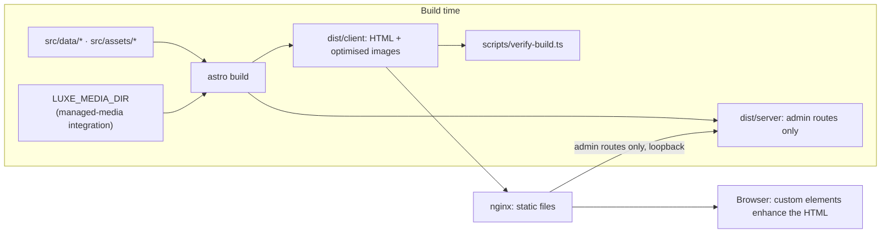
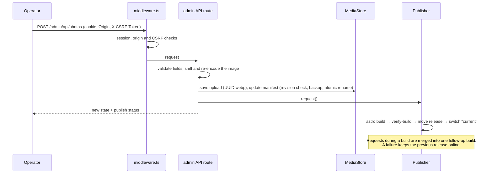

# Architecture

The high-level picture is in the [README](../README.md#architecture). This document follows the
code paths.

## Boundaries

- **Public site:** `output: 'static'`. Only `src/pages/index.astro` and `src/pages/sitemap.xml.ts`
  are rendered, at build time. No request ever reaches application code.
- **Admin:** the routes under `src/pages/admin/` set `prerender = false` and run on the Node
  adapter (`@astrojs/node`, standalone). `scripts/verify-build.ts` fails the build if anything
  under `admin` appears in the static output.
- **No runtime dependencies on external services.** Booking (Drago), WhatsApp, Instagram, Waze
  and Google Maps are plain outbound links built from confirmed configuration
  (`src/data/luxe.ts`, `src/data/links.ts`, `src/lib/drago.ts`) and checked against an
  allowlist at build time.

## Source layout

| Path | Responsibility |
|---|---|
| `src/pages/` | The home page, the sitemap and the admin page and API routes |
| `src/layouts/BaseLayout.astro` | Document shell, SEO metadata, Open Graph, JSON-LD (`WebSite`, `BeautySalon`) |
| `src/components/hero/` | Hero and the first-visit intro (`ScissorsIntro.astro`, gated before first paint) |
| `src/components/sections/` | Services and the Mundo LUXE globe, works showcase, the space experience, visit section |
| `src/components/ui/` | Shared pieces: lightbox, icons, external links, live "open now" status |
| `src/scripts/` | Client behaviour, one custom element per experience (`luxe-specialties`, `luxe-showcase`, `luxe-space-tour`, `luxe-lightbox`, `luxe-hours`, `luxe-open-now`) |
| `src/lib/` | Pure, DOM-free logic: sphere and quaternion math, orbit and camera geometry, opening hours, manifest validation, media resolution |
| `src/data/` | Business configuration, media catalog and publication policy, services, portfolio copy, space tour |
| `src/server/` | Admin runtime: config, password hashing, sessions, login throttling, image intake, media store, publisher |
| `src/integrations/` | Astro integrations: managed media (virtual module) and local `.env.admin` loading in `astro dev` |
| `src/styles/` | Design tokens (`tokens.css`) and section/scene styles |
| `scripts/` | Build verification, admin password setup, publishing, icon/OG/demo-media generators |

Pure modules in `src/lib/` hold the geometry and state rules, so most behaviour is unit-tested
without a browser; the scripts in `src/scripts/` only read the DOM, call that logic and write
transforms (at most once per animation frame, idle when nothing moves).

## Media pipeline

1. `src/data/media-catalog.ts` lists every image and clip with its id, category, alt text and
   **publication permission** (see [media-policy.md](media-policy.md)).
2. `src/data/media.assets.ts` imports each file so `astro:assets` can optimise it.
3. `src/data/media.ts` keeps only what the policy allows for the current mode (build or
   `astro dev`) and applies the admin's manifest (`src/lib/media-resolve.ts`): edited texts,
   replacements, retired photos, added photos and custom order, by stable id.
4. The globe (`src/data/globe.ts`), the portfolio (`src/data/portfolio.ts`) and the space tour
   (`src/data/spaces.ts`) are built from that single list, so a photo keeps its place everywhere.

## Admin content flow

- The manifest (`manifest.json`) and uploads live in `LUXE_MEDIA_DIR`, outside the repository
  and the published folder, so deployments and rebuilds never lose them.
- Every write is a serialised read-modify-write with an expected revision (stale views get a
  `409`), a backup of the previous manifest and an atomic rename.
- Uploads are decoded and re-encoded to WebP under a server-generated UUID; originals are never
  served and files are never overwritten.
- Saving triggers `src/server/publisher.ts`: `astro build` into a staging folder, the same
  `verify-build.ts` checks, then an atomic switch of the `current` symlink. Any failure keeps the
  previous release online. Without `LUXE_SITE_DIR` (local work) publishing is a no-op.

## Deployment (non-sensitive overview)

nginx serves the static release and proxies only `/admin/` to the Node process on loopback,
with request limiting. A systemd unit runs the admin with a restricted filesystem view.
Generic examples: [`deploy/`](../deploy/README.md).
