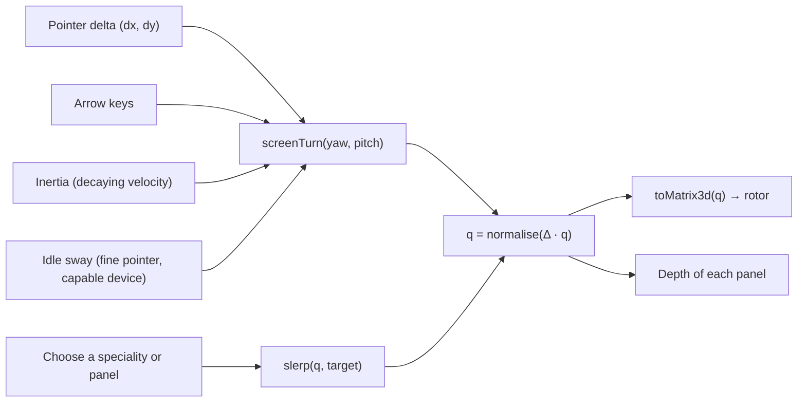

# Case study: the world of LUXE, a CSS 3D globe

Production site. In motion: <a href="../../showcase/production/globe-drag.webp">7 s loop</a> · <a href="../../showcase/production/globe-recording.webm">11 s recording (WebM)</a>

Section 01 of the home page, *«Un mundo de belleza, en un solo lugar.»*, lists the five
specialities next to a sphere of panels: works, interiors, two muted video loops and, where a
speciality has nothing publishable, an emblem with its name. Visitors can turn the sphere in
any direction, pick a speciality from the list, or open any panel in the shared viewer.

## Goals

- Show the range of the studio in one place, without turning the section into a gallery wall.
- Make the interaction feel physical (drag, throw, settle) and never get stuck or flip.
- Keep the list, the captions and the booking link usable with no motion at all.

## Composition ([`src/data/globe.ts`](../../src/data/globe.ts), [`src/lib/sphere.ts`](../../src/lib/sphere.ts))

`buildGlobe` is a pure function: catalog in, panel list out.

- **Points.** `fibonacciSphere(n)` spreads `n` points evenly, with at least 26 panels and 6
  decorative facets, so the sphere never looks sparse when little media is publishable.
- **Equator.** Seven slots about 51° apart hold the featured clip and each speciality's
  representative photo, so choosing a speciality from the list is always one short turn.
- **Mix.** Remaining works are placed with `spreadByTag` so the nearest neighbours of a panel
  are from other categories.
- **Fallbacks.** A speciality without publishable photos gets one emblem panel carrying its
  name, never a photo of something else. No photo or clip is repeated to fill space.
- **Sizes.** The featured clip is 1.36 × larger; panels near it shrink so it is not covered.

Each panel is placed with `rotateY(lon) rotateX(lat) translateZ(R)`, so it is tangent to the
sphere and upright along its meridian.

## Rotation ([`src/lib/quaternion.ts`](../../src/lib/quaternion.ts), [`src/scripts/globe-rotor.ts`](../../src/scripts/globe-rotor.ts))

The whole sphere turns as one object: one `matrix3d` on a rotor element. Its orientation is a
unit quaternion `q`.

Why quaternions:

- Composing a small **screen-space** turn onto the current orientation means "drag right"
  always turns the sphere right as seen by the visitor, whatever its current pose.
- There are no Euler angles, so nothing has to be clamped at the poles: the sphere rolls through
  them without gimbal lock and without the sudden 180° flip a yaw/pitch model shows.
- `slerp` gives a constant-speed, shortest-path turn when the visitor chooses a speciality.

Interaction details from the code:

| Behaviour | Value |
|---|---|
| Drag vs click | 6 px movement threshold |
| Inertia | Exponential decay, τ = 260 ms (`decay` in `sphere.ts`); a gesture that rested before release carries no throw |
| Settle after a drag | The nearest panel with depth ≥ 0.9 (≈ 26° from the front) is eased into place |
| Idle sway | ±4.5° sideways, ±1.8° tilt, fading in after 4 s; stops on hover or focus |

## Video coordination ([`src/lib/globe-media.ts`](../../src/lib/globe-media.ts), [`src/scripts/globe-video.ts`](../../src/scripts/globe-video.ts))

- **One clip at a time:** the most frontal clip whose depth is at least 0.64 (≈ within 50° of
  the front).
- **Hysteresis:** a playing clip keeps playing until its depth drops below 0.5, so a small sway or a
  hesitant drag never toggles it.
- **Conditions:** the section is on screen, the page is visible and the viewer is closed.
- **Loading:** a clip receives its `src` only the first time it is due to play; others keep their
  poster. Images are requested as the globe approaches the viewport (`IntersectionObserver`,
  300 px margin), with `<noscript>` images for no-JavaScript visitors.

## Motion and accessibility

- `prefers-reduced-motion`: no idle sway, no inertia, no settling, no entrance animation, and
  posters instead of clips. Turning reduced motion on mid-animation stops it in its final state.
- Save-Data: posters only.
- Idle sway only with a fine pointer and more than four CPU cores.
- The speciality list is a set of real buttons with arrow, Home and End keys; selection is
  announced to screen readers.

## Testing

- `tests/quaternion.test.ts`, `tests/globe.test.ts`, `tests/globe-media.test.ts`: composition
  rules, equator slots, no repeated media, emblem fallback, hysteresis, settle threshold.
- `tests/e2e/mundo-luxe.spec.ts`: the video plays inside the rotor, only one at a time, pauses
  when turned away or off screen; full turns in all four directions; drag is not a click.
- `tests/e2e/phase4-regressions.spec.ts`: keyboard, hover intent, reduced motion, missing scripts.

## Trade-offs

- CSS 3D cannot sort intersecting planes; the layout avoids intersections instead (panels are
  tangent and spaced), and depth shading comes from the computed depth.
- The ambient sway is cosmetic and costs frames on weak devices, which is why it is limited to
  capable hardware.
