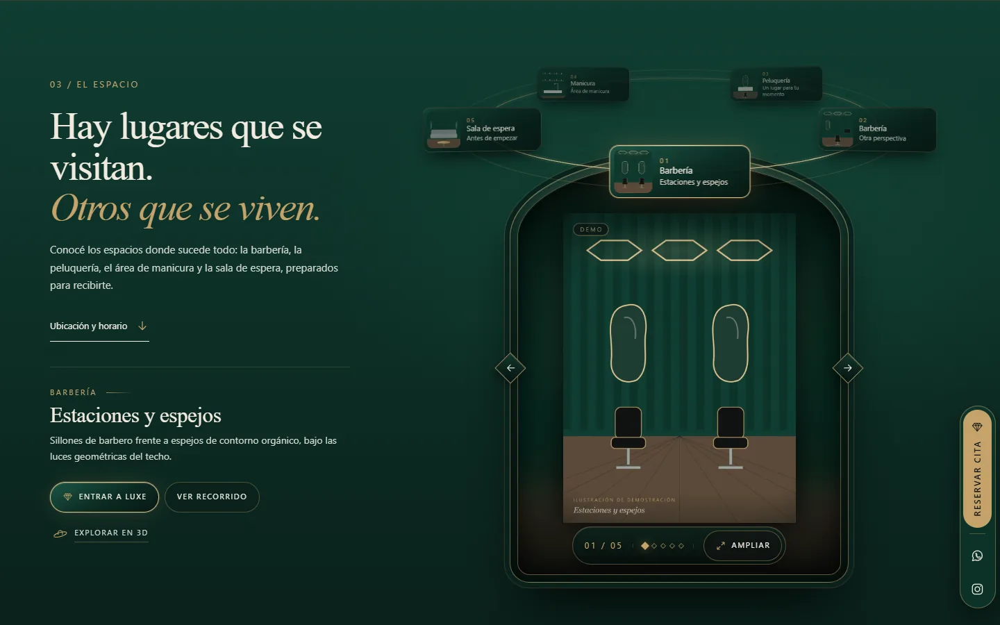
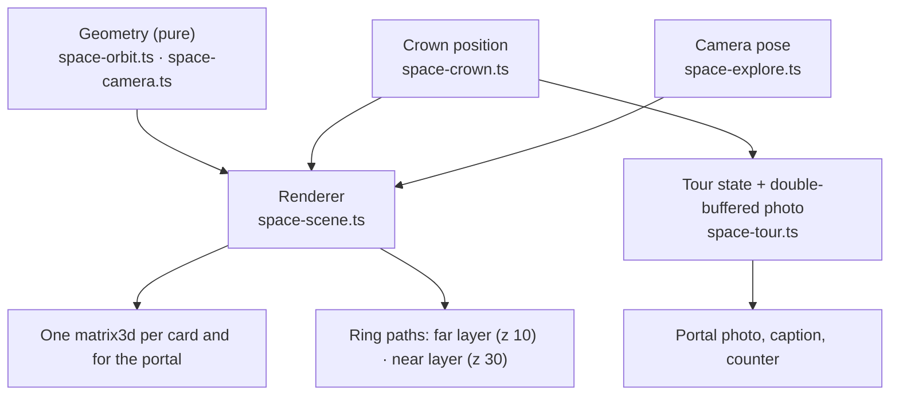
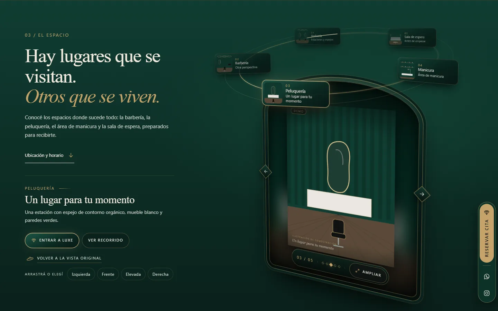

# Case study: the space, an orbit inspired by Saturn's rings

Section 03, *«Hay lugares que se visitan. Otros que se viven.»*, introduces the rooms of the
studio: the barbering stations from two angles, the hair station, the manicure area and the
waiting room.

## From an image to an interface

**Inspiration.** The visual brief for this section described an orbital crown, the rings of
Saturn and a portal. A previous version showed the rooms as a vertical list of thumbnails.

**Interpretation.** Room cards ride an inclined ring. The selected card comes to the front:
lowest, largest, brightest, with a gold border. An arched portal frame in the centre shows
the selected room's photo. The ring passes in front of the portal on its near half and behind
it on its far half, as Saturn's rings pass in front of and behind the planet.

**Engineering.** That image became three independent pieces:

## Geometry

**The crown** ([`src/lib/space-orbit.ts`](../../src/lib/space-orbit.ts)). `crownPose(offset, count)`
returns a card's position on the ellipse in unit fractions of its radii (`ox = sin θ`,
`oy = cos θ`), plus scale, opacity and depth; the back card is drawn at 64 %. CSS turns the
fractions into pixels with the same radii used to draw the rings, so cards and rings always line
up at every breakpoint. The server writes the initial pose inline, which means the crown is
already composed without JavaScript.

**The camera** ([`src/lib/space-camera.ts`](../../src/lib/space-camera.ts)). The section's own
layout is lifted into 3D: x to the right, y down, z towards the visitor, with the portal as the
plane `z = 0`. A camera with a position, an orientation and a target orbits an ellipse around the
portal's axis. Each element gets `projection × view × model` as one `matrix3d`. Cards are flat
planes on the ring, so photos are never bent over a curved surface. At rest the portal's
projection is the identity, so the default composition is exactly the flat layout.

**The rings** ([`SpaceRings.astro`](../../src/components/sections/SpaceRings.astro)). Each ring is
sampled point by point, projected through the camera and drawn as an SVG path in screen space,
split into a far half (behind the portal) and a near half (in front). Lines keep their width at
any angle and occlusion is correct. The outer and inner rings have slightly different tilts, so
they slide past each other when the camera moves.

**Paint order** follows depth: cards behind the portal plane (11–19), far ring (10), portal (20),
near ring (30), cards in front (31 and up), sorted by distance to the lens. The section creates its
own stacking context so these values never compete with the fixed header or the mobile dock (see
[testing.md](../testing.md#lessons)).

## States

Two states are kept apart on purpose:

| State | Changed by | Never changes |
|---|---|---|
| Crown position (which room is selected) | Card click, arrows, keys (←/→/↑/↓, Home, End, Enter), swipe on the photo, drag on the crown | The camera |
| Camera pose (`yaw`, `pitch`, `distance`, `dive`) | *«Explorar en 3D»*, the viewpoint buttons, drag in 3D mode, the guided tour | The selection |

The tour keeps two values, the committed choice and the photo actually on screen. The portal keeps
the previous photo until the next one has loaded, shows a discreet loading cue meanwhile, and
offers a retry if an image fails.

## «Explorar en 3D»

- The camera leaves the rest pose and four viewpoint buttons appear (left, front, elevated,
  right), with `aria-pressed` and keyboard access.
- **Mouse:** horizontal drag orbits, vertical drag changes the viewing angle. **Touch:** only the
  horizontal gesture orbits (`touch-action: pan-y`), so the page still scrolls vertically.
- **Weight:** the camera follows the hand with a 130 ms time constant; on release it keeps a
  limited impulse that decays in 260 ms; limits are elastic (`rubber`) rather than hard stops.
- **Guided bounds** by width (`orbitBounds`): yaw ±52° / pitch −4…28° on desktop, ±40° on tablets,
  ±30° / −2…22° on phones, so the scene never turns to an angle where it disappears.
- Cards turn partly towards the camera so they stay readable and are never seen from behind.
- *«Entrar a LUXE»* moves the camera into the portal to an interior view of the selected photo;
  *«Ver recorrido»* plays a guided camera path. Both return to the exact rest composition.

## Motion and accessibility

With reduced motion there is no entrance, no animated turn, no ambient light sweep and no residual
effects; selection changes are immediate. The rooms are real tabs with names, the counter is text,
and *«Ampliar»* opens the shared viewer.

## Why CSS 3D and not WebGL

The project notes for this phase record that WebGL/Three.js was considered and set aside:

- the scene is five cards, a portal and four rings, so a 3D library and duplicated photo textures
  would add weight without adding depth CSS 3D cannot give;
- real DOM keeps tabs, focus, screen-reader names, `srcset`, the double buffer, the shared viewer
  and the no-JavaScript fallback;
- there is no WebGL context to manage or lose.

The cost is writing the matrices by hand, which is why all of the geometry lives in pure,
unit-tested modules.

## Testing

- `tests/space-orbit.test.ts`, `tests/space-camera.test.ts`: crown poses and wrapping, camera
  projection, identity at rest, ring paths, bounds, rubber limits, viewpoints, paths.
- `tests/e2e/espacio-orbital.spec.ts`: rapid mixed navigation never leaves the portal empty or
  showing the wrong photo; drag with inertia and settle; touch vs vertical scroll; keyboard; viewer;
  reduced motion; layouts at 360–1440 px.
- `tests/e2e/espacio-3d.spec.ts`: camera modes, viewpoints, entering and leaving the portal.
