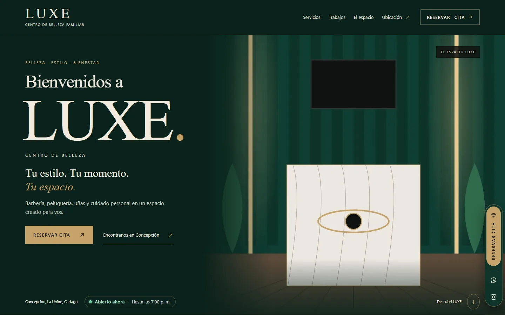
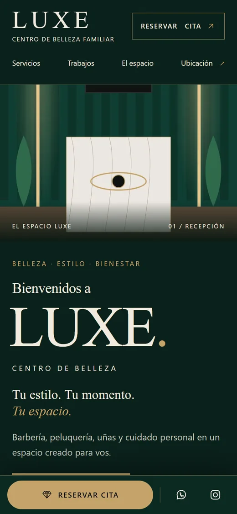

# Design engineering

How the visual identity is turned into code, and the principles shared by every interactive
piece. Each experience has its own case study:

- [The world of LUXE: a CSS 3D globe](case-study/interactive-globe.md)
- [The editorial portfolio](case-study/editorial-gallery.md)
- [The space: an orbit inspired by Saturn's rings](case-study/orbital-experience.md)

Rationale that is not recorded in the project documents or the code is marked *to be confirmed*.

## From the studio to tokens

  
  

The brief's art direction, *The Emerald Atelier*, came from the studio's own photos: deep green
walls, black panels, organic and geometric mirrors, warm light, black chairs, marble and metal
details, and a logo built around a diamond. The palette was sampled from those images and marked
provisional until the brand files arrived.

| Source | Implementation |
|---|---|
| Palette | [`src/styles/tokens.css`](../src/styles/tokens.css): `--emerald #103d32`, `--deep #0a211b`, `--ink #101211`, `--gold #c5a36a`, `--ivory #f1eadf`, semantic aliases (`--color-surface`, `--color-accent`…) |
| Gold as an accent, not as text | The brief restricts gold for small text unless contrast is validated; gold is used for lines, numbers, borders and calls to action |
| Editorial type | `--font-display` (`Bodoni MT`, `Didot`, serif fallback) for headlines, `--font-body` (`Segoe UI`, Arial) for text; system fonts only, so rendering varies slightly by OS. *Typeface choice to be confirmed.* |
| Diamond motif | Drawn in SVG, never a copy of the logo: [`Icon.astro`](../src/components/ui/Icon.astro) (`diamond`), the ribbon in [`EditorialTransition.astro`](../src/components/sections/EditorialTransition.astro), the portal's diamond arrows, the footer gem and the video play mark |
| Spacing and scale | `--space-*`, `--container-*`, fluid `--text-title` and a gutter that respects safe areas |
| Desktop "scenes" | [`src/styles/scenes.css`](../src/styles/scenes.css): above 64 rem × 34 rem each main section fills one screen (`--scene-h`, `--scene-avail`, a title size bound to width and height); below that the page flows normally. No fixed heights, no scroll-jacking, no scroll snapping. |
| Focus | A visible gold outline everywhere, switched to emerald on light sections ([`global.css`](../src/styles/global.css), [`ui.css`](../src/styles/ui.css)) |

Section rhythm alternates surfaces: dark hero, ivory services, ink works, emerald space, ivory
visit, so each scroll stop reads as a new room.

## The opening: «El corte LUXE»

The brief described a short intro: a scissors icon cuts across the screen and the two halves
separate to reveal the brand. The implementation
([`ScissorsIntro.astro`](../src/components/hero/ScissorsIntro.astro),
[`src/scripts/intro.ts`](../src/scripts/intro.ts), [`src/lib/intro-state.ts`](../src/lib/intro-state.ts)):

- runs a synchronous gate as the first element of `<body>`, before the hero paints;
- lasts 1.5 s, once per browser session (`sessionStorage`), and never locks scrolling or input;
- is skipped entirely with reduced motion, and also when the page is hidden mid-intro;
- leaves the decorative overlay hidden if its script fails or is blocked.

## Motion principles

Shared by the intro, the globe, both crowns and the camera:

1. **Content first.** Every section is complete HTML before scripts run; scripts enhance it.
2. **One writer per frame.** Controllers batch DOM writes into one `requestAnimationFrame` and stop
   when nothing moves.
3. **Physical but brief.** Inertia decays exponentially (τ = 260 ms in the globe and the camera)
   and always comes to rest on a whole item.
4. **Reduced motion is a first-class path,** not a degraded one: entrances, sway, inertia and
   settling are skipped and changes are immediate. Switching it on mid-animation finishes in the
   final state.
5. **Respect the device.** Save-Data shows posters instead of video; ambient effects need a fine
   pointer and a capable CPU; touch gestures never hijack vertical scrolling.
6. **No animation library.** CSS, the Web Animations API and `requestAnimationFrame` were enough.
   The brief allowed an animation library only if a prototype proved it necessary.

## Business features in the interface

- **Booking:** the platform's public booking URL is built only from a validated slug
  ([`src/lib/drago.ts`](../src/lib/drago.ts)). It is reachable from the header, the sections and
  the action dock, which is a side rail on wide screens and an opaque bottom bar on phones
  ([`ActionDock.astro`](../src/components/layout/ActionDock.astro)).
- **Opening hours:** a live "open now" status computed in Costa Rica time, whatever the visitor's
  time zone ([`src/lib/opening-hours.ts`](../src/lib/opening-hours.ts),
  [`src/scripts/opening-hours.ts`](../src/scripts/opening-hours.ts)).
- **Visit:** the facade, hours, Waze as the main route and Google Maps as an alternative
  ([`VisitSection.astro`](../src/components/sections/VisitSection.astro)).
- **Local SEO:** canonical URL, Open Graph and `BeautySalon` / `WebSite` JSON-LD built from
  confirmed data only ([`src/data/structured-data.ts`](../src/data/structured-data.ts)).

## To be confirmed by the author

- The reasons behind the typefaces and the scissors intro.
- Performance budgets and target devices used during design.
- Whether the diamond motif was supplied by the business or derived from the logo during design.
